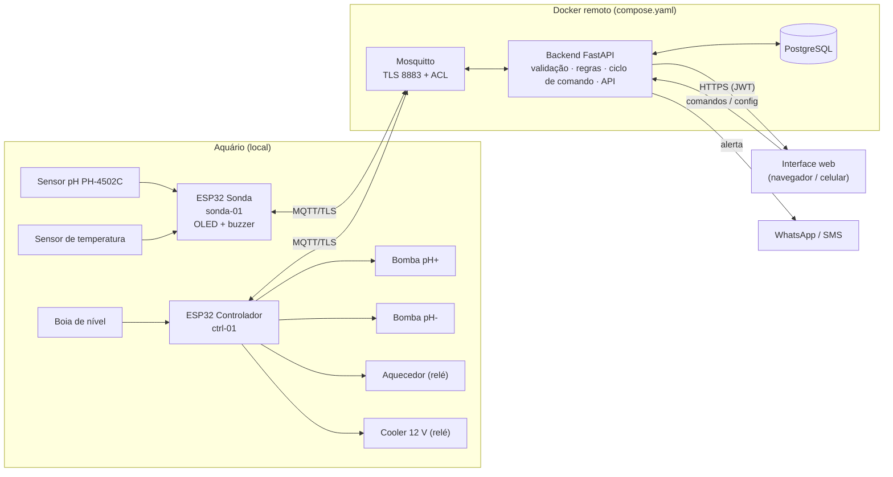
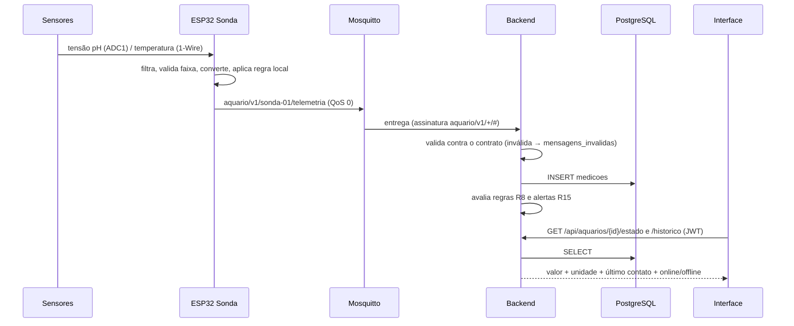
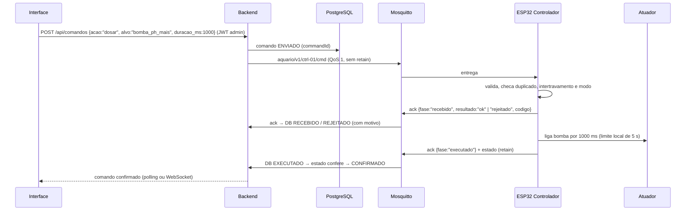

# CP12 — Proposta de upgrade do projeto N1 → N3 (seções 1 a 4)

| Identificação | |
|---|---|
| **Equipe** | Aquário Inteligente |
| **Projeto (N1 → N3)** | Monitor de pH com ESP32 + MQTT → Aquário Inteligente: monitoramento e correção automática de pH e temperatura |
| **Integrantes presentes** | Gabrieli Eduarda Lembeck · Heloisa Rebello Cabral · Julio Bezerra de Mattos Manoel · Mileine da Silva de Freitas · Thomas Henry Steinback |
| **Data / Versão** | 20/10/2026 — v1.0 (entrega parcial: seções 1 a 4) |

> Os diagramas estão em Mermaid, que o GitHub mostra como imagem. Os pontos **[PENDENTE]** são decisões
> da equipe ainda em aberto, declaradas como pede o checkpoint.

---

## 1. Ponto de partida: o projeto da N1

| | |
|---|---|
| **Problema e usuário** | **Usuário:** o aquarista (doméstico ou de loja pequena) que passa o dia fora e mantém peixes ou plantas sensíveis a variações de água. **Problema:** pH e temperatura mudam ao longo do dia (respiração, CO₂, decomposição, clima). Fora da faixa da espécie, isso causa estresse, doença e morte. Hoje a medição é manual, com kit de gotas, feita de vez em quando, e ninguém percebe o problema quando está longe. |
| **O que funcionou na N1** | Leitura real de pH (PH-4502C no GPIO35, divisor 10k/10k, filtro de 15 amostras pela parte central, calibração por reta). Display OLED local. Wi-Fi com reconexão. Telemetria MQTT com TLS (8883). Servidor FastAPI que assina o pH, compara com a faixa 6,5–7,5 e publica `ON`/`OFF`. ESP32 que executa o comando no atuador (LED). Dashboard web e servidor em Docker. |
| **Limitações conhecidas** | Só pH, sem temperatura. O atuador é só o LED da placa (GPIO2, pino de strapping). Não há confirmação do comando por MQTT, `commandId` nem Last Will. O histórico fica em memória (50 leituras) e some ao reiniciar. Não há autenticação no painel nem na API. O broker público (`test.mosquitto.org`) não tem usuário/senha nem valida certificado. Não há regra local nem estado seguro. A reconexão do Wi-Fi bloqueia o loop (~20 s com `delay`). A calibração é fixa no código. O servidor só roda na rede local. Não há alerta externo nem testes automatizados. `secrets.h` continua rastreado pelo Git. |
| **Proposta de valor** | O aquário se cuida sozinho: mede pH e temperatura o tempo todo, **avisa no WhatsApp** quando algo sai da faixa e **corrige sozinho**, dosando pH+/pH- em pequenas doses e ligando aquecedor ou ventilação. Tudo com travas de segurança (limite de dose, intertravamento, estado seguro) e um histórico para entender o comportamento do aquário. É mais barato que um controlador comercial e funciona de qualquer lugar. |

**Pedido de troca de projeto:** ☐ Sim ☒ **Não** — o projeto da N1 comporta o upgrade, mantendo o mesmo problema e o mesmo usuário.

---

## 2. Upgrade por camada

| Camada | Como era na N1 | Como será na N3 |
|---|---|---|
| **Hardware** | 1 ESP32, sensor de pH PH-4502C, OLED SSD1306, LED da placa como "atuador" | **2 ESP32.** A **Sonda** tem pH, temperatura (sensor à prova d'água), OLED e buzzer. O **Controlador** tem 2 bombas peristálticas (pH+ / pH-) via MOSFET, um relé para o aquecedor e outro para o cooler, e uma boia de nível. Fonte de 12 V + regulador de 5 V, GND comum, caixa com acabamento. |
| **Firmware** | Loop com `millis()`, mas com `delay()` na reconexão. Sem regra local. Calibração e limites fixos no código | Máquina de estados **AUTO / MANUAL / SEGURO**. Leitura sem bloqueio e validada (faixa plausível, valor-sentinela). Regra local que funciona sem rede. Configuração em NVS (faixas, calibração, intervalo). `deviceId`, hora por NTP, Last Will, OTA. |
| **Comunicação (MQTT)** | 2 tópicos (`sistema/aquario/ph`, `.../atuador`), payload sem versão nem id, comando `ON`/`OFF` retido | Contrato versionado em `CONTRATOS.md` (a criar): `aquario/v1/<deviceId>/{telemetria, estado, cmd, ack, status}`. JSON com `v`, `deviceId`, `ts` e unidades. Comando com `commandId`, confirmação em 2 fases (recebido / executado) e catálogo de erros. Broker próprio (Mosquitto) com TLS validado, usuário/senha e ACL por dispositivo. |
| **Backend** | (não existia como serviço completo) FastAPI só repassava a faixa → `ON`/`OFF` e guardava 50 leituras em memória | FastAPI que valida cada mensagem contra o contrato (descarta e registra as inválidas), grava no banco, roda as regras (R8), controla o ciclo dos comandos (R7), dispara notificações por WhatsApp/SMS e expõe uma API REST autenticada (JWT). É o **único** componente que publica comandos. |
| **Banco de dados** | (não existia) | PostgreSQL com tabelas de dispositivos, medições, comandos, eventos de comando, alertas, configurações e usuários. Esquema versionado (migrações). |
| **Interface** | Uma página com o pH atual e o último comando, sem login, faixa fixa no HTML | Aplicação web com login e identidade visual. Mostra o valor atual com unidade, o último contato, online/offline, alertas ativos, gráfico do histórico com média móvel e tempo fora da faixa. Permite enviar comandos (dosar, ligar, modo) e alterar a configuração (faixas). Cada comando aparece com seu estado (enviado → recebido → executado → confirmado / rejeitado). |
| **Decisão/regra** | Servidor: pH fora de 6,5–7,5 → LED `ON`. Sem histerese, sem direção (ácido ou alcalino dão o mesmo `ON`) | **Remota (backend):** pH abaixo do mínimo (média de 5 min) → dose pH+; acima → dose pH-; respeitando o intervalo mínimo entre doses e a dose máxima por hora. Temperatura com histerese → aquecedor ou cooler. Alertas por condição. **Local (firmware):** buzzer/OLED fora da faixa crítica, limite de tempo de bomba, intertravamentos e estado seguro sem rede. |

---

## 3. Conferência contra o piso R1–R18

| Req. | Como o projeto vai atender |
|---|---|
| **R1 Hardware** | Duas entradas de tipos diferentes, **pH** (analógico, ADC1/GPIO35) e **temperatura** (digital), mais a boia de nível no Controlador. Atuadores reais: 2 bombas peristálticas 12 V (MOSFET com diodo), relé do aquecedor e relé do cooler 12 V, além do buzzer. Nenhuma carga ligada direto em GPIO. Fonte de 12 V com regulador de 5 V, a dimensionar. **[PENDENTE — até 27/10]** confirmar o modelo do sensor de temperatura e fechar a lista de compra dos atuadores. |
| **R2 Firmware** | Leitura sem bloqueio por `millis()` (pH a cada 2 s, temperatura a cada 5 s). Validação: pH entre 0 e 14, temperatura entre 0 e 45 °C, ADC saturado e o −127 °C do sensor desconectado. **Regras locais:** Sonda → buzzer + OLED quando fora da faixa crítica. Controlador → dose máxima de 5 s, nunca pH+ e pH- juntos, nunca aquecedor e cooler juntos, aquecedor bloqueado com nível baixo. **Estado seguro:** bombas e cooler desligados, aquecedor no próprio termostato. Reconexão sem bloqueio ao Wi-Fi e ao broker, refazendo as assinaturas. Configuração em NVS (faixas, calibração, intervalo) alterável por comando. `deviceId` próprio, hora por NTP (ou `ts_sync:false`), logs no Serial. |
| **R3 Contrato MQTT** | Arquivo `CONTRATOS.md` no repositório (v0 na entrega completa, congelado como v1 em 27/10). Tópicos de telemetria, estado, comando, confirmação e status (Last Will). JSON com `v`, `deviceId`, `ts` e unidades. Lista de comandos e faixas, confirmação com `commandId` e resultado, catálogo de erros, QoS e retain justificados por tópico. |
| **R4 Backend** | FastAPI (evolução do `ph-server`). Assina `aquario/v1/+/#`, valida com modelos Pydantic gerados do contrato, grava as inválidas em `mensagens_invalidas`, persiste no Postgres e expõe a API REST (estado atual, histórico, comandos, configuração, alertas). Só o backend tem permissão de publicar em `.../cmd` (ACL no broker). |
| **R5 Banco de dados** | PostgreSQL. `medicoes` (device_id, grandeza, valor, unidade, ts), `comandos` (command_id, origem, ação, parâmetros, enviado_em, resultado, confirmado_em), `comando_eventos` (fase e horário de cada mudança), `alertas`, `dispositivos`, `configuracoes`, `usuarios`. Migrações versionadas (Alembic ou SQL em `db/`). |
| **R6 Interface** | Web servida pelo backend. Cards por aquário com pH e °C atuais, último contato, selo online/offline (vem do Last Will), alertas ativos, gráfico do histórico, botões de comando e formulário de faixas. O comando só aparece como executado depois da confirmação do dispositivo. |
| **R7 Ciclo de comando** | Estados registrados: **enviado** (backend grava e publica) → **recebido** (ack `fase:recebido`, aceito ou rejeitado com motivo) → **executado** (ack `fase:executado`) → **confirmado** (estado publicado bate com o comando e aparece na interface). Um comando proibido (ex.: dosar pH- com pH+ em andamento, ou modo SEGURO) é rejeitado com `E_INTERTRAVAMENTO`. Sem confirmação em 10 s → `expirado`. |
| **R8 Decisão remota** | **Regra 1:** média móvel de 5 min do pH abaixo de `ph_min` (configurável), sem dose nos últimos 15 min e abaixo do limite de doses por hora → comando `dosar` na bomba pH+ por 1 s (simétrico para pH-). **Regra 2:** temperatura abaixo de `temp_min` → aquecedor ON até `temp_min + 0,5 °C`; acima de `temp_max` → cooler ON. Os comandos passam pelo mesmo ciclo do R7 com `origem: "regra:<nome>"`. |
| **R9 Segurança básica** | Login com usuário e senha (hash bcrypt) e token JWT. Rotas de comando e configuração só para usuário autenticado. Credenciais em `.env` (com `.env.example` versionado) e, no firmware, em `secrets.h` fora do Git ou na NVS. **[PENDENTE — até 27/10]** tirar `codigo/secrets.h` do controle de versão (`git rm --cached`); hoje ele não contém senha. |
| **R10 Falhas testadas** | Plano dos 4 cenários obrigatórios: (1) queda do Wi-Fi → regras locais continuam, bombas param, a interface mostra offline pelo Last Will e reconecta sozinha; (2) broker parado → o firmware tenta reconectar sem travar, o backend marca o broker como indisponível e envia alerta; (3) sensor desconectado (−127 °C ou ADC saturado) → leitura `valido:false`, estado SEGURO, alerta; (4) comando inválido ou repetido → ack `rejeitado` com `E_PAYLOAD_INVALIDO` / `E_DUPLICADO`, sem executar. Evidências: logs, prints do MQTT Explorer e consultas ao banco em `docs/testes/`. |
| **R11 Entrega executável** | README com pré-requisitos, `.env.example`, `docker compose up -d`, gravação do firmware pela Arduino IDE (ou `arduino-cli`) e passo da OTA. Tag/release `v1.0.0-N3` com a versão defendida. Commits de todos os integrantes. |
| **R12 Orquestração** | `compose.yaml` com `mosquitto` (TLS + senha + ACL), `postgres` (volume persistente) e `backend` (API + interface), subindo com um único comando. Roda num **Docker remoto** (VM na nuvem). Variáveis sensíveis só no `.env`. |
| **R13 Múltiplos dispositivos** | 2 ESP32 físicos: `sonda-01` (sensores) e `ctrl-01` (atuadores), cada um com `deviceId`, credencial MQTT e ACL próprios. A interface mostra os dois separados. **[PENDENTE — até 27/10]** confirmar se a equipe já tem o segundo ESP32 ou se precisa comprar. |
| **R14 Painel analítico** | Na própria interface (Chart.js): pH e temperatura das últimas 24 h e 7 dias, média móvel de 30 min, **% do tempo fora da faixa**, nº de doses por dia e uptime de cada dispositivo, tudo calculado do histórico real no Postgres. |
| **R15 Notificação externa** | **WhatsApp** pelo backend quando há pH ou temperatura fora da faixa por mais de 10 min, dispositivo offline por mais de 2 min, falha de sensor ou modo SEGURO. Com intervalo mínimo entre alertas iguais. **[PENDENTE — até 27/10]** escolher o provedor: CallMeBot (WhatsApp, grátis) ou Twilio (SMS/WhatsApp, pago após o trial). |
| **R16 Segurança avançada** | Os **dois**: (a) Mosquitto com certificado de uma CA própria na porta 8883, com o ESP32 validando a CA (`setCACert`, sem `setInsecure`), usuário/senha e ACL por dispositivo; (b) perfis **administrador** (comanda e configura) e **visualizador** (só vê), checados na API. |
| **R17 OTA** | OTA por HTTPS disparada por comando MQTT `ota` (URL, versão, sha256), servida pelo backend. Usa `HTTPUpdate` do ESP32 com partição dupla e rollback se a nova versão não conectar. A versão aparece no tópico `estado`. |
| **R18 Testes e CI** | `pytest` no backend: validação do contrato, regras R8 (histerese, intervalo entre doses), ciclo de comando e duplicidade. GitHub Actions rodando os testes e compilando o firmware com `arduino-cli` a cada push e pull request. |

---

## 4. Arquitetura-alvo

### Diagrama de blocos

### Fluxo do dado (sensor → firmware → MQTT → backend → banco → interface)

### Fluxo do comando (interface → backend → MQTT → firmware → atuador → confirmação)

